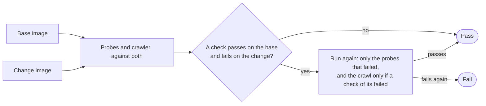

# CI pipeline

Deterministic gates (spec 4.1). Part of the [GitHub plane](README.md#github-plane).

- **v1:** GitHub Actions on GitHub-hosted runners, with a target under 3 minutes and the jobs in parallel.
- **Later:** visual regression and performance budgets for the app, an active DAST scan, load tests.

## The jobs

- lint and format;
- type-check;
- the generated files checked against their sources, and the console's built browser code against its budget, in gzipped bytes (`apps/console/budget.json`): what its first view loads, the entry chunk and the CSS it links, held to a tenth over a build, and everything the build makes, lazy pages included, held loosely, so that moving code into a lazy chunk lowers the figure that counts and a new lazy page needs no review;
- unit and integration tests;
- the manifests rendered;
- the app's gates ([shared gates](SHARED-GATES.md)), the journeys among them;
- the console's browser tests, in the pinned Playwright image, its visual snapshots among them, and its first meaningful view timed, within two seconds on a throttled phone, on a runner of its own;
- ZAP's baseline scan of the console signed in as Martin;
- each image built, and a runner's prepare step run in the runner image ([agent runners](AGENT-RUNNERS.md#trying-a-runner)).
- for a change to what the cluster runs, the cluster made from the change ([the platform check](#the-platform-check)).

Beside them, not on every pull request, the daily scan (`vulnerabilities.yml`, [security scanning](SECURITY-SCANNING.md#the-daily-scan)) runs each day, on each push to `main` and by hand; a pull request that changes the scan itself runs it in its proving mode, read-only, against its base, which uploads nothing.

## The platform check

A chart, a value, a third-party image, k3s, k3d or Argo CD's pin is proved before it merges by a cluster made from the change itself (`platform.yml`). It runs `make up` on the runner, at the commit it checks: the cluster from the change's `deploy/k3d/cluster.yaml`, with the k3d its `mise.toml` pins; Argo CD by the Makefile's own line; root, and every chart's values, at that commit (`make up REVISION=<commit>`, the same path a try of a branch takes on the Mac). It passes when every Application is Synced and Healthy (the website, from the app's `main`, settled as `make up` waits for it, its health being its release's), every image policy on the cluster enforces, and `make admission-ready` passes. Then, from a cluster that came up, it takes each refusal record with its own script, and uploads them as the run's artifact, `refusal-records`, so a record a change stales is taken again from a cluster made from the change, never edited. Last, every pod of the cluster must be running and ready, none restarting (`scripts/platform-pods.sh`): Argo CD counts a Deployment with no readiness probe as available each time its container starts, and calls it Degraded only after its ten-minute progress deadline, later than the check ends. A pod waiting (a crash loop, an image it cannot pull, a config it cannot read), not ready (running and failing its readiness, or exited and not yet started again), Pending, Failed, or last restarted within two minutes fails the check by name, after up to three minutes for one that restarted lately to settle; a Job's pods count only while the Job has not completed. The rule is set from green runs, whose workers restart while Postgres and the migrations come up, the latest three to eight minutes before the end.

- **What runs it** is `scripts/check-kind.sh platform`: a change, on a pull request or in the merge queue, to anything the cluster is made from or runs (`deploy/`, the Makefile, mise's pins, the workflow, the scripts it runs and the modules they import, each named file by file, which a test holds to their imports). The factory's App's deploy pin of our own images never does: those images were built from commits already merged, so the merge decides nothing ([ADR 0017](../architecture/adr/0017-the-worker-queues-the-local-deploy-pins.md)). For anything else the job is skipped, which the ruleset counts as passed; `platform` is a required check.
- **It holds nothing.** It runs the change's own scripts and manifests, so its token reads the contents and nothing else; the job that decides reads, too, the public pull request the queue's branch names, as `check.yml`'s does. No job names a secret, and each refuses any event but a pull request and the merge queue's. The cluster gets none of the keys `make up` takes from the Keychain, each of whose Secrets is optional, so it comes up whole and opens and attempts nothing: the gateway has no key to call a model with (and a new store's line calls none), the GitHub worker runs no pod and the line watches no release (`make up PLATFORM_CHECK=1` patches both into root, from `deploy/argocd/platform-check.yaml`), so nothing reads GitHub but Argo CD and the image pulls, and Alertmanager has no Pushover token to send with. A key of any kind would have it try: the worker, given one, acts as the App and polls GitHub each pass. `make up` says each is missing, and what that leaves out, in its log, and the job prints the gateway's and the worker's logs, and Alertmanager's notification counts and log. Its toolchain comes from `main`'s cache, which it never writes.
- **What it costs.** It makes the whole cluster, the factory's workers included, as `make up` does: 9 to 13½ minutes to make it from nothing, every image pulled afresh, and 11 to 15 for the job, at a peak of 7.8 GiB of the hosted runner's 16 and 15 GB of its disk. A change that breaks a chart fails within 20 minutes of `make up` starting, and in a few when Argo CD cannot render it; one whose pod never pulls its image stays Progressing, not Degraded, and takes the 20. `scripts/platform-watch.sh` stops the wait at 20 minutes, or sooner on what waiting will not mend: an Application Argo CD still cannot render after the hard refresh the watch asks for on first seeing the error (its failed render is otherwise cached until a resync minutes later), or one Degraded for five minutes, which a cluster coming up is not for long, and at the ceiling it names each Application and resource it waited for; the website and root, whose health is the release's, are not judged so.
- **It fails safe.** A cluster that does not come up holds the pull request, and what it showed (each Application's state, the pods, the warnings, and each pod not running's description and logs; no Secret is read, though a pod's log may print what it was given, and every password and key in the cluster is made on the runner for that cluster alone, and goes with it) is the run's artifact `cluster` on every outcome but success, as well as its log; it can fail for reasons that are not the change's, a registry's pull among them, and a run again is the answer to those.

## ZAP's baseline scan

`make zap` runs it on the Mac, as CI's `zap` job does (`apps/console/zap/scan.ts`), against the console's server and the [admin service](ADMIN-SERVICE.md) on one origin, behind a proxy standing in for Traefik, on a throwaway store. A browser enrols a passkey through the console's enrolment page with a virtual authenticator, so it signs in as Martin's does and no image holds a way in made for tests. ZAP's baseline (its spider, then its passive rules, which read each answer and send no attack) then runs in its pinned image, with Martin's session and token on every request, reading the pages the console's script draws and the admin service's answers too (`hooks.py`).

- **Any finding fails it,** unless `apps/console/zap/rules.tsv` keeps an exception with its reason beside it; a test fails an exception with none.
- **A scan that reached nothing fails too:** it must have read the page and Martin's session, signed in.
- **A ZAP that stops before it answers stops the scan then,** with ZAP's log, rather than after zap-baseline's ten-minute wait. Its proxy has a port of its own, below the range outgoing connections take theirs from, since on Linux it shares the runner's network.
- **Its rules are the newest this ZAP can run, on each scan,** beta ones included: ZAP's image moves by hand, but zap-baseline.py, started without `-silent`, updates ZAP's add-ons (`-addonupdate`) and installs the beta passive rules (`-addoninstall pscanrulesBeta`) as it starts, when ZAP's add-on store answers. A rule published after the pin still finds what it looks for, unless it needs a newer ZAP, so a new finding can fail a pull request that changed nothing, and is read and fixed or given an exception in `rules.tsv` like any other.
- The report is the job's artifact, `zap-report`.
- It passes into the required `browser tests` check, as the browser tests do.

## Journeys

The base's and the change's images are built and run as containers in the runner, and `factory gate journeys` runs the probes and the crawler (with axe) against both at once.

- **It fails** on a check that passes on the base and fails on the change twice.
- **Nothing on the visitor's device, nothing from elsewhere.** Each probe also answers `<probe>/device`: whether, by the end of it, anything is on the device, a cookie or anything a script stores (local or session storage, IndexedDB, Cache Storage, a service worker), or its pages asked another origin (`senses/device.ts`, `senses/observe.ts`). It is keyed on the probe's own route, so the base's and the change's are the same check. The app keeps nothing on a visitor's device, so a change whose pages start to keep anything there, or to ask another origin, fails as any check that regresses does. Reading it adds milliseconds to each probe. Verify and the probes that look after the live app do not ask.
- **A check the base could not tell about** (the crawler's trouble) is reported, not failed on.
