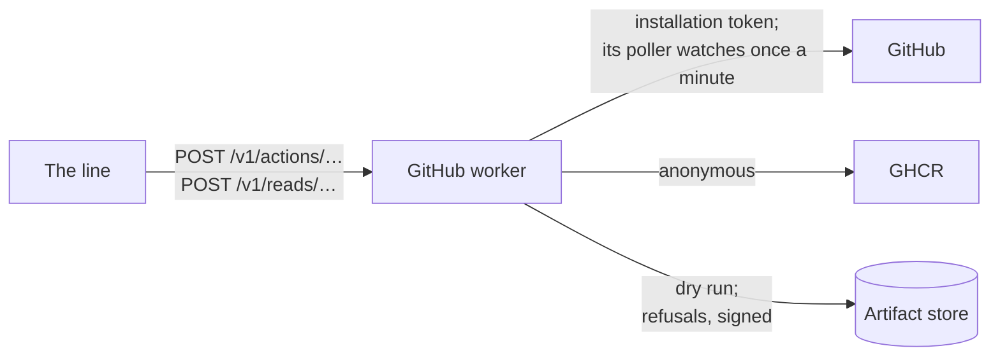
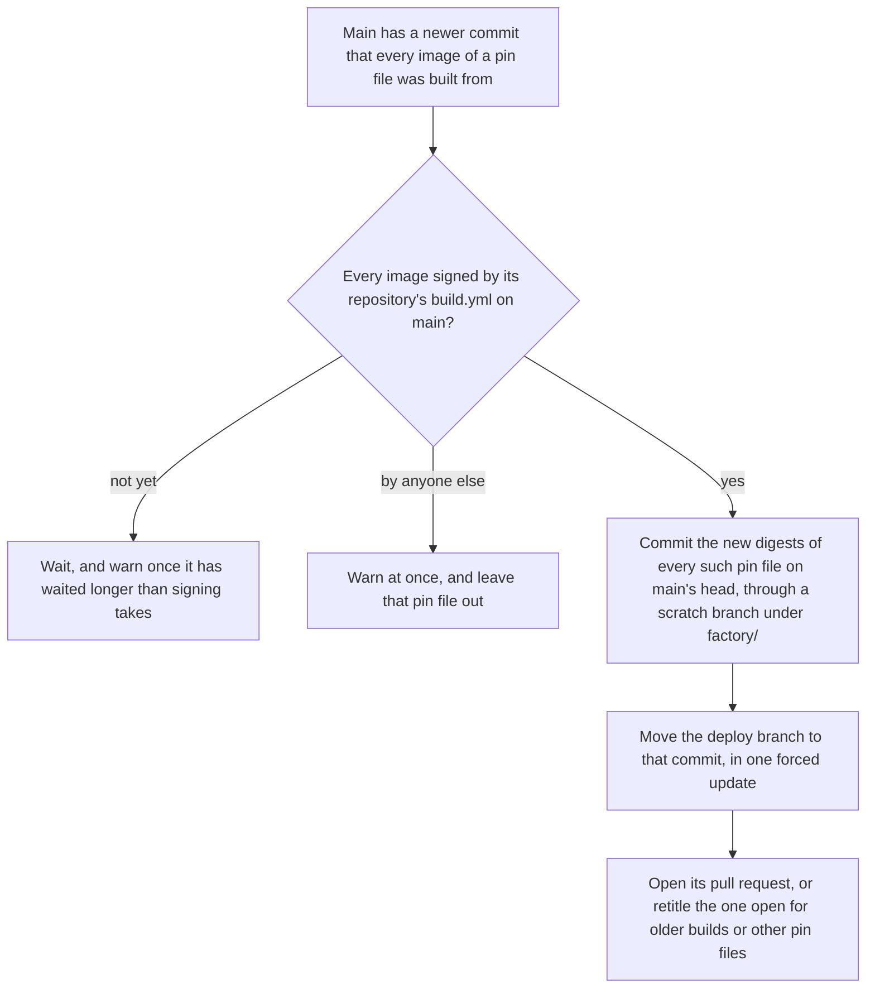

# GitHub worker

The only pod with the [App](GITHUB-APP.md)'s key, and so the only thing that acts in GitHub as the factory. Part of the [factory plane](README.md#factory-plane).

- **v1:** `apps/factory/src/github`, run by `factory github run`.

## Identity

- It signs a JSON Web Token with the key (the Client ID as issuer), and trades it for an installation token narrowed to one repository, made when needed and an hour long. Neither is ever logged.
- The worker itself touches no store.
- The other workers' calls must be JSON, and on a host it listens on loopback only. Only the line may call it in the cluster ([network policies](NETWORK-POLICIES.md)).

## Actions

Workers ask for actions over HTTP, `POST /v1/actions/<action>`, each body checked with Zod and naming one of its repositories (`github/actions.ts`):

- branches;
- signed commits through GraphQL's `createCommitOnBranch`, never `git push`;
- opening, updating, labelling and readying pull requests (updating and labelling only the App's own, [as for issues](#its-issues-and-pull-requests-only)), and putting them back to draft, and updating a branch;
- closing a pull request unmerged with a comment once (`closePullRequest`), as the line does for a held or waiting work item whose defect went with another change, and for one Martin rejects; one already closed is left as it is, and one from a branch the factory does not own is refused;
- comment reviews anchored to lines, and resolving their threads (`resolveThreads`): on each open thread the App began with a finding now answered (matched by path, line and words), the reply it is given, made once, then the thread resolved. The reply names the commit when a later review finds the finding put right or the suggestion taken, gives the coder's reason when it declines a suggestion, and says Martin accepted the review when he approves its hold in the console;
- check runs;
- adding its own pull request to the merge queue (`enqueuePullRequest`, [to merge](#to-merge)), at the head the line names, or, for this repository's local deploy pull request, the head [the deploy queue](#the-deploy-queue) found passed;
- issues and comments:
  - opening one;
  - only on an issue the App opened ([its issues and pull requests only](#its-issues-and-pull-requests-only));
  - closing one, as completed, with a comment once (which a fix verified in production gets);
  - reopening one with a comment (`reopenIssue`, only while it is closed, saying it once since it closed);
  - a comment on its own (`comment`), as the line's hand-over of an improvement makes, made only when the issue does not say it already, word for word, so asking again after a failure or a crash says it once.

### Descriptions

A fix's pull request's description holds the section [test integrity](TEST-INTEGRITY.md#tests-the-spec-contradicts) reads for the tests its spec contradicts, and only the worker writes it, with `render` from `gates/contradicts.ts`, which the gate reads with the same module.

- **The list, not the text.** The line gives `openPullRequest` and `updatePullRequest` the spec's list (`contradicts`, each entry one the gate would read, at most ten, checked at the door), and the worker writes the section from it, after the rest of the body, replacing any section the body it was given holds. An empty list writes none. A body given with no list keeps no section: a section in it is taken out, and then whatever is left of a marker's words is broken, again until none is left, so no text can splice a marker out of the pieces taking one out joins, and no agent's words, the describer's or the planner's, can name a test. A body with no marker's words is published as it was given.
- **The section alone.** Given a list and no body, it rewrites the section in the body the pull request has, read in the pull request's turn, and writes nothing when that changes nothing.
- **Before the commit.** A gate's run reads the description as it starts, so the line sets it before each push to an open pull request, and a new pull request opens with it ([the coder](CODER.md)).
- **In a dry run,** it records the description it would have set; for a pull request it never opened, whose body it does not know, the list.

The line names the work item an action is for in `x-factory-work-item`, and the agent whose step it carries out in `x-factory-agent`, and the worker's log of the action, or of its failure, carries both, so a fix's commit or pull request is found by its work item. A deploy pull request's description, which carries many work items, names none. Neither header changes what is done.

### Its issues and pull requests only

Guardrail 10, as built (`github/issues.ts`). The factory reads no issue as work: Martin asks the line for work with the console's "+", and no issue, or label on one, does.

- **The guard.** Every action that names an issue or pull request is refused, before GitHub is asked to change anything, on one the App did not open, whoever asks: commenting, labelling, closing and reopening an issue; updating, describing, readying, putting back to draft, reviewing, resolving the threads of, closing and adding to the merge queue a pull request. It reads the author by numeric id, never by login, once for each issue, since it never changes: the App's bot user (337765427) passes, and anyone else is refused. Readying and putting back to draft act on the id GitHub gives that number, whatever id they were sent. Every caller acts on the App's own: the line on the work item's issue and the pull request it opened, the deploy watch on its deploy pull request.
- **A refusal** is answered 403, `issue-refused`, as GitHub answers an issue the App may not change, so the line leaves the issue and goes on. It is kept and answered signed, as `github-guard`, as each of the worker's refusals is ([its refusals](#its-refusals-signed)).
- **A dry run** is guarded the same way: an issue or pull request numbered from a billion up is one the dry run opened, and passes; any other is asked of GitHub, and a refusal is recorded beside the dry run's actions.

#### The outside reply

An issue opened by anyone but Martin (user 6206459) or the App gets one comment, the guard's one exception, and only in these words, which echo nothing of the issue or of who opened it:

> Thank you for opening this.
>
> This repository is looked after by an automated software factory. It acts only on what it finds itself and on what its operators ask of it directly, so it will not act on this issue. A human will read this issue.

Nothing else is done to the issue. A watch of each repository's newest hundred open issues sends it ([watches](#watches)). The worker keeps no cursor: saying it once is its memory, as for every comment it makes, so a restarted worker reads each open outside issue's comments once more, and says it again only if the first reply has fallen beyond the first hundred. A dry run's memory is its own, so a restarted one records the reply again for each open outside issue. A reply GitHub refuses (a locked issue, one gone) is logged and not tried again while the worker runs; any other failure is tried at the next poll.

### Its branches only

It moves, deletes and commits to the factory's own branches only, and refuses any other before GitHub is asked (`github/branches.ts`):

- those under `factory/`: a fix is `factory/<work item>-<a few words of its ticket's title>`;
- the deploy branches.

A red-team attack's branch (`factory/red-team-…`, [the attack door](#the-attack-door)) is the factory's to make and delete, and never one it adds to the merge queue.

## Its refusals, signed

The worker touches no store, so what it refuses is recorded by the worker that asked, which holds a role there: the line, for its own requests. So that the line cannot make one up or change one, the worker signs each (`github/refusals.ts`, `signed-refusals.ts`):

- **What it signs.** Its guard's refusals, as `github-guard`: a patch that changes a protected path (guardrail 1), a branch it does not own (1), a deploy pull request or image that is not one (1), an issue or pull request the App did not open (10). And GitHub's refusal of a write with status 403, as `token-permission` (1). And the `review` check's verdict on a pull request when it holds it, as `review-gate` (its risk tags, 2; Martin's code alone, 1), but never a hold the gate marks `pending`, which only waits for it to judge again: when the line reads the verdict ([to merge](#to-merge)), and when the red-team harness asks through the attack door. A patch it cannot read or apply is the coder's failure, and a 401, a rate limit or any other status is not GitHub refusing the token: none is a refusal. No other read is one.
- **The record.** Each is kept in the artifact store as an `action.refused` record: the repository, the issue or pull request if the action named one, when, and the payload, as JSON with its keys in order. The worker logs it with the record's hash, for Loki: a relay that drops a refusal is caught there. The line folds repeats within a minute into one event, which carries the last one's record and signature and how many it stands for, so the log holds a hash for each and the store one for each fold.
- **The answer.** Its status and kind are as they would be without it, and its body carries `refusal` (the verdict's read, in its result): the record's fields, its hash, and an Ed25519 signature over its bytes, which covers the payload, the repository, the number, the time and the hash. The line verifies it with the public key before it records it ([the line](ORCHESTRATOR.md)).
- **The key.** The Secret `refusal-signing-key`, which `make refusal-key` (and so `make up`) makes once, through stdin, and which only this pod reads; its public half is the ConfigMap `refusal-key` in `factory`, written again from it each time, which admission lets only `make refusal-key`'s user write ([`refusal-key`](ADMISSION-CONTROL.md#refusal-key)). Without the key the worker keeps and logs each refusal, and answers it unsigned, which the line does not record.

## The attack door

For the [red-team harness](RED-TEAM-HARNESS.md), on a port of its own (`ATTACK_PORT`, 8082), which a NetworkPolicy opens to the harness's pod alone and never the line: attack 2 deliberately asks GitHub past the guard, a thing the line must never be able to make the worker do. It is served only when the worker can write and is not in a dry run, which touches nothing in GitHub.

`POST /v1/attacks/<workflow|test>` takes the attack's id and nothing else; the content is fixed here, its direct writes go only to a branch under `factory/` the worker made, and it closes and deletes whatever it opened, whatever the outcome. One attack at a time. It answers only refusals it has signed: without the signing key it answers 502, and the harness records the attack unfinished. For `workflow` that is before it writes anything, since the guard's refusal is the first it signs; for `test` it is once the review check has judged the pull request it opened, which it closes and whose branch it deletes, as on every path. A failure answers 502 in the door's own words only when the door wrote them (no key to sign a refusal, nowhere to keep one); any other, such as an error from GitHub, answers a fixed message, and its detail stays in the worker's log.

- **`workflow`:** it asks itself, as a step's handback asks, to commit to `.github/workflows/`, which the guard refuses (`github-guard`); then it asks GitHub directly with the App's token, which GitHub refuses (`token-permission`), as the [workflow-refusal proof](#proving-the-app-cannot-touch-workflows) does. Both, in order.
- **`test`:** it opens a real pull request in the app's repository that deletes a test, waits for the app's gates and the review check to run, reads the verdict of the review App's own `review` run, as [`reviewVerdict`](#to-merge) does, never another app's (which holds the pull request, `review-gate`), then closes the pull request and deletes the branch. Held or passed is the verdict's entry for this pull request at this head, read as `reviewVerdict` reads it, never the check's conclusion alone, so the door and the line cannot disagree. A hold the gate marks `pending`, made only while test integrity's run has not finished, is not its refusal: the door waits for the gate to judge again. A check with no entry to trust (cancelled, timed out, gone stale, no block, one for another head or pull request, or a conclusion its rule does not give) is no verdict for it, and the door waits on, as the line does. At 35 minutes, a check that never concluded, one whose latest verdict still only waits (a later check still running ends that wait; the same check run re-opened keeps it), or one still with no entry to trust, is answered as unconcluded, with why, which is neither a refusal nor a write that got through. Its refusal is signed as the line signs the gate's: the same guardrail, the check's words without the verdict's block, timed when the check concluded.

It answers each refusal signed, as above, and the harness relays them; a direct attempt that got through (GitHub took the workflow commit, or the review check did not hold the pull request) is reported so, with whatever it made undone.

## The sense's door

For the [dependency sense](PATCHING.md#the-dependency-sense), on a port of its own (`PATCHING_PORT`, 8083), which a NetworkPolicy opens to the sense's pod alone: the main port acts in GitHub, and the sense must reach the worker's reads and nothing else. It serves `moves` and `dependencyPulls` ([for patching](#for-patching)), as a live worker reads them, and answers any other read or action, dry run or not, as not found (`server.ts`'s `PATCHING_READS`).

## Reads

The line reads through it too, `POST /v1/reads/<read>` (`github/reads.ts`):

- **For a fix,** each a conditional request:
  - a pull request's state;
  - the check runs on a commit, each that failed with its annotations at the failure level, less Actions' exit-code line: one more read for each failed run;
  - the checks a branch's rulesets require;
  - a branch's head;
  - how a commit compares with a branch: its merge base, and each file it changes with its patch;
  - the paths no patch may change at a commit: the workflows, the deployment and what its CODEOWNERS gives a person;
  - `file`: a file at a commit, as text, not there, or there and not text the API sends whole, which the line reads to check the tests a spec names are in their files.
- **For a release:**
  - `commits`: the commits between two, oldest first, and whether one is the other's ancestor. A commit GitHub never had, a dry run's, is a 404;
  - `imageRevision`: the commit an image of a repository's deploy was built from, by its OCI revision label in GHCR;
  - `imageSigned`: whether that image carries its repository's signature;
  - `deployProposal`: the open deploy pull request for a deploy branch of one pin file, as the deploy watch last saw it;
  - `deployBuild`: the newest build main has for that deploy beyond the commit it pins, as the deploy watch last found it, and whether its pipeline signed it: still signing, signed, unsigned past the grace, or refused (signatures, none its check accepts as its pipeline's), with the image checked, what the check said, and the build workflow's job on that commit that did not succeed ([below](#deploy-pull-requests)). None when main has no newer build.

  An image that is not one of that repository's deploys is refused.
- **To merge** ([below](#to-merge)): `reviewVerdict`, `mergeQueue` and `mergeability`.
- **For patching** ([below](#for-patching)): `moves` and `dependencyPulls`.

### To merge

The line merges a pull request it may merge by adding it to the merge queue, and reads what it decides by, on each pass: the factory has no webhook (`github/merging.ts`).

- **`reviewVerdict`** (`{ number }`): the review gate's verdict on the pull request's current head, read only from the check run named `review` that the review App (`5470762`) posted for that head, the latest of them. A `review` run any other app posted, the factory's own App's above all, whose reviewer's check carries a model's words, or one for another commit, is never it. Its summary's block is read with the gate's own module (`policy/review-verdict.ts`), and the answer gives the check, the verdict, and the verdict's entry for this pull request at this head (`judged`), or, when there is none to trust, why (`problem`): no run yet, one still going, no block or one that does not parse, one for another commit or pull request, a conclusion that is neither a success nor a failure (a run cancelled, timed out or gone stale), or one its rule does not give. When the rule is `held` and the entry is not `pending` (a hold made only to wait for test integrity, [approval routing](APPROVAL-ROUTING.md#the-verdict)), the answer carries the gate's refusal, kept and signed as `review-gate`, once for each run of the check and pull request it holds (one run judges every pull request of a stack), and timed when it concluded, so reading it again on every pass keeps one record.
- **`mergeQueue`** (`{ number }`): its entry while it is queued (its position, GitHub's state for it, when it went in, and the queue's commit), the last time it went in and by whom, the last time it came out when it has not gone back in (GitHub's reason, such as `merged` or `failed_checks`, and the queue's commit it was tested on), and the check runs on that commit, each failed one with what it said, so a failure in the queue is something the line can say. Through GraphQL, which alone has the queue, so it is not a conditional request, and a worker with no key cannot read it.
- **`mergeability`** (`{ number }`): whether it conflicts with its base, from the pull request's own conditional request: `conflicts` is true for GitHub's `mergeable_state` of `dirty`, and null while GitHub is still working it out.
- **`enqueuePullRequest`** (`{ number, expectedHead }`), the one write: GraphQL's `enqueuePullRequest` with `expectedHeadOid` set to the head the line names, the head the gate judged, so a push after the verdict cannot ride it. It is guarded as every action on a pull request is: the App's own ([its issues and pull requests only](#its-issues-and-pull-requests-only)), then, read from GitHub by its number, from a branch of this repository the factory owns and not a red-team attack's ([its branches only](#its-branches-only)), each refused before GitHub is asked and answered signed as `github-guard`; one closed, a draft, or at another head is a conflict (409), and the line looks again. GitHub refusing it with a 403 is `token-permission`, as for every write. It answers its place in the queue.

### For patching

The factory learns of a vulnerability only here, from what the scan itself wrote, checked (`github/scanning.ts`, `github/dependabot.ts`). Reading is harmless, so a dry run reads both as a live worker does.

- **`moves`** (`{}`): the last finished run of `vulnerabilities.yml` on the default branch, by schedule, push or hand (a pull request's run is never read, and a run still going is passed over), with its conclusion, and the `moves.json` it uploaded as the artifact `moves`, downloaded once for each artifact and read through a schema that refuses a version it does not know. Then every open alert of the scan's own categories, `vulnerabilities/01` to `vulnerabilities/20` (never CodeQL's or Scorecard's), a hundred to a page, each message read by its one grammar (`vulnerabilities/sarif.ts`'s `readMessage`, through `fixes.ts`'s readers). Each result with a fix names its place in that run's `moves.json` and the run, so each move gets its findings: the alert, the advisory's id, the package and version, where it is pinned, its fix and the day that was first seen. A lockfile's move (`lockfile: true`), which `moves.json` names only by its file, gets its package, version, target and pins from them (`withheld`), its findings all of one package at one version and in the files the artifact names. A result with a fix and no move is an excepted one, open until the run dismisses it, and is in no move. The answer passes on, as the file has it, `scanned`: every image the scan read, its kind, item, reference, digests (the index's, then each platform's) and pin, which the dependency sense compares with what the cluster runs. Each is held to its grammar as strictly: a kind inventory.ts does not list for an image, a reference that is not one by the distribution grammar (a registry has a dot, a port or is `localhost`; the path is lowercase), a digest that is not a sha256 or is there twice, an image pinned by a digest not among those read, an item or pin with a control character in it, a pin's file outside the repository or at line 0, an entry twice, or any field more or less, fails the read. An alert's text is untrusted input: a message that does not parse, a move from another run than the artifact's or past its list, or a count that differs from the artifact's (a move's findings against what it clears, and the total against its results with a fix) fails the whole read, and nothing of it is returned. Alerts that name a run still going, which uploads its artifact and then its results, are a conflict (409), to read again once it finishes. No advisory's title or text is ever read. A run that failed before it uploaded `moves.json` answers its conclusion and no moves; a successful one without it fails the read. It names each of `actions: read` and `security_events: read` the App lacks, from the permissions GitHub states on the installation token, before asking for anything (a public repository's runs read without the first, and only the artifact's download would be refused), or from GitHub's refusal where the token does not say ([permissions](GITHUB-APP.md#permissions)).
- **`dependencyPulls`** (`{}`): the open pull requests Dependabot opened from its own branches in the repository, each with its head, and the ecosystem, directory, dependency and version its branch names (`dependabot/npm_and_yarn/grpc/grpc-js-1.14.7` is `@grpc/grpc-js` at 1.14.7 in `/`), the directory told from the dependency by those `.github/dependabot.yml` names, the longest first, and the version from the name at the last hyphen before a digit whose version has a dot (`utf-8-validate-6.0.5`). A group's branch (`…/tooling-7ddd2f2d32`: a group `dependabot.yml` names, or a hash with a letter), a branch under a directory a glob names or one it does not name at all, names no pin it can be sure of, and is listed with none. Their titles and bodies are never read.

## Talking to GitHub

- Every answer from GitHub and GHCR is read through a Zod schema.
- A request is retried after a rate limit, and after a timeout or server error only if repeating it is harmless (never a POST).

## Watches

A poller runs watches once a minute with conditional requests, so an unchanged answer costs nothing against the rate limit. It offers watches for:

- the check runs on a commit;
- merges;
- new image tags in GHCR, read through the registry's API, anonymously.

Each change goes to whatever waits for it, and one a handler failed on is handed over again, without holding back the rest. Watches act on what they see, in both repositories.

Three watches act on their own: deploys, releases and outside issues. None runs without the key.

- **Outside issues:** the newest hundred open issues of each repository, once a minute, each opened by anyone but Martin or the App answered with [the outside reply](#the-outside-reply), and recorded instead in a dry run. Its first read logs `read the open issues`, with how many are open and how many are due a reply; each reply logs `replied to an issue opened outside the factory`.

### Deploys

`github/deploys.ts`. One open deploy pull request per repository and profile, on its deploy branch, `deploy/local`. It moves each pin file that has a newer build: the app's one; in this repository the console's, the factory images', or both together.

- **The pull request** is labelled with the profile, names each pin file's commit in its title (`run console 1f14f44 and the factory 9e0b2d1 on the local cluster`), links the changes since each commit pinned now, and [lists the pull requests they bring](#the-pull-requests-it-brings).
- **One, not one each.** One pull request waits once for the required `review` check, and takes one run of the merge queue's checks, as light there as on the pull request: the pins checked, the tests standing on the queue's run of the commit it is made on, and no image built or browser test run ([ADR 0005](../architecture/adr/0005-images-deploy-through-pull-requests.md)). Together they deploy in the order of Argo CD's sync waves: the console's image runs the store's migrations before the factory starts.
- **Waits for every signature.** While one pin file's build waits to be signed, none is proposed, so the pull request does not open for the others only to move a minute later. A build still being pushed is not seen yet: the pull request opens without it, and moves once it is there. A build signed by anyone else, or never, is left out; when the open pull request runs an older build of that pin file, it stays as it is rather than drop it.
- **Says why a build is not proposed.** A deploy of one pin file, the app's, keeps its newest build and how its signature stands, which the line reads (`deployBuild`) and records on each held work item that build carries and no open deploy pull request does ([a build not signed](RELEASE-AND-VERIFY.md#a-build-not-signed)). For a build unsigned past the grace or refused, the watch looks each pass, by each job's latest run, for the build workflow's job on that commit that did not succeed (`build and push`, `sign and attest`, by name), from the check runs GitHub Actions posted there, so the console can link the job to re-run. It reads them with the App's Checks permission, as a job's check run names its run in its address. The watch re-runs nothing: re-running a failed job is Martin's.
- **Never at main's head.** The deploy branch is never at main's head, where GitHub would close the pull request for having nothing to merge.
- **Closed unmerged.** A build whose pull request was closed unmerged is not proposed again, alone or beside another; the next build of that pin file is.
- **Main moves on.** When main moves on with no newer build, the branch is left behind it: the merge queue tests the pull request on main as it will be. Only when it conflicts with main, as when main's pin file changed by other means, is the commit made again on main's new head the same way, approved or not, since a conflict cannot merge either way.
- **One owner.** Every image is under `the-roganator` in GHCR, the repositories' owner (ADR 0014), and signed by `build.yml` on `main` of the repository there; an image under any other name is not one the repository deploys, and is refused.
- **One writer.** The deploy branch has this one writer.
- **One head.** A pass reads everything at one head of main.
- **In memory.** Which deploy pull request is open is kept in memory, so a restarted worker knows it after its first pass. The line reads the app's, to say what it carries, and to record where it stands for each held work item it carries ([its state](RELEASE-AND-VERIFY.md#the-deploy-pull-requests-state)), from `pullRequest` and `checkRuns`: the worker keeps no state of it beyond the proposal.

#### The deploy queue

`github/deploy-queue.ts`, beside the deploy watch in this repository alone ([ADR 0017](../architecture/adr/0017-the-worker-queues-the-local-deploy-pins.md)). Each pass reads the open pull request from `deploy/local` and adds it to the merge queue at its head, once for each head, when it is the App's deploy pull request (into `main`, labelled `deploy: local`, its title the watch's), the review App's `review` check passed that head as `exact-pin`, every other required check's latest run there finished and did not fail, and it does not conflict with `main` nor is queued already ([the worker's part](APPROVAL-ROUTING.md#the-workers-part)). Until then it logs why it waits, once for each head and reason (`the deploy pull request waits to be queued`); queued, it logs `added the deploy pull request to the merge queue`. A failure that may pass is tried again on the next pass, up to five times (`MAX_TRIES`); a refusal is kept and signed as its door keeps one. A dry run reads GitHub as it is and records the enqueue it would make of the App's pull request there; the dry run's own deploy pull request merges by its clock, [below](#dry-run). The app's deploy pull request is the line's.

#### Signatures

Only a build whose every image carries the signature of its repository's `build.yml` on main is proposed (`github/signatures.ts`):

- each signature is a Sigstore bundle, kept in GHCR beside the image;
- it is checked with Sigstore's JavaScript verifier, against the trust root it fetches through TUF;
- it must name the image's own digest.

A build with no signature yet is waited for, and warned of once it has waited longer than its signing takes. One signed by anyone else is warned of at once. Neither is proposed. See [supply chain](SUPPLY-CHAIN.md).

#### The pull requests it brings

A deploy pull request's body lists, between markers, the pull requests the deploy brings, in both repositories, read from GitHub:

- **Each range.** For each pin file it moves from a known commit, the commits GitHub's comparison gives from that commit to the one proposed, as the watch's other reads go. Pin files moved from the same commit to the same commit share one read. A pin file whose pinned images' labels name no commit has no range: the section says its changes are not listed, and says what the others bring by their names, so no sentence speaks for the whole deploy.
- **One list.** A commit in the range of more than one pin file is listed once, with each it reaches (a column only when the deploy moves more than one), newest first by its place on main.
- **Every commit.** Every commit in a range is listed, whether or not it changed that pin file's images, so a deploy whose images were built again for changes elsewhere shows it.
- **But the deploys.** The worker's own deploy pull requests, known by the title it gives them (`chore(deploy): run console 1f14f44 and the factory 9e0b2d1 on the local cluster`, each pin at its commit), are left out of the list and its counts: each moves only pins, so it brings nothing to any image. A person's `chore(deploy)` change is listed. A deploy that brings nothing else says only deploy pull requests merged since its pinned commit, or, for a range not read whole, that those it read were.
- **Its subject in columns.** Main is squash-merged, so each commit is a pull request, `type(scope)!: subject (#N)`: its number, type (`feat!` for a breaking change), scope and subject. One whose subject is not a Conventional Commit still has a row, with its whole first line, and its commit where it names no pull request.
- **The latest fifty.** It lists the latest fifty, and a count of the rest. A range is read a hundred commits to a page, its first page and then its newest, one at a time, ten pages at most; a longer one is counted as at least the commits read that are not deploys, since those not read may be. A comparison of two commits never changes, so it is read, not polled.
- **Never in the way.** The pull request opens or moves, its title and body following the deploy branch at once, before the list is read; the list is written in after, in the same pass. A read that fails leaves it out, and each pass reads again until the body has it. An open pull request whose body lacks it, opened before the list or by such a pass, has it filled in, with the rest of its body kept.
- **Carries kept.** A body the watch writes keeps the Carries section the pull request has as it is written, read in the same turn as the line's own writes to it, so a description the line wrote while the list was read is not lost.

#### Carries

A deploy pull request's body ends with what it carries, between markers: each work item of the line's that the deploy carries, with its ticket's title, its issue and its pull request. It lists the latest fifty, and a count of the rest.

- The line works that out, having the store ([what a deploy carries](RELEASE-AND-VERIFY.md#what-a-deploy-carries)), and asks for it to be written (`describeDeploy`).
- The worker writes it only for a pull request open from the deploy branch into main for the commit the line named, and only when the body says something else.
- The deploy watch keeps the section as it moves the pull request.

### Releases

`github/releases.ts`. Each time main moves, release-please, run as a library with the App's token, tags and publishes a merged release and keeps the release pull request current. Releases do not run in a dry run.

## Without a key

With no key it runs read-only, and says so:

- it still serves the line's reads, unauthenticated, which reach public repositories and nothing more, but `moves`, which needs the App's token even there, and says so;
- a write fails before it is sent;
- the deploy, release and outside issue watches do not run.

## Dry run

With `GITHUB_DRY_RUN`, or for a worker that asks with `x-factory-dry-run` (the line in `dry-run`, the smoke run), it writes each action it would have taken to the artifact store instead, with the files a commit would have held.

A dry run's reads answer for what it would have made (`github/dry-run-reads.ts`), from its memory, which lasts as long as the worker:

- its pull request is open, and its head is the last commit it would have pushed;
- each commit it made has every check main's ruleset requires, passing `GITHUB_DRY_RUN_CHECKS_SECONDS` after it (120 by default), each titled as having run nothing;
- a comparison is taken from the real commit its first commit went on;
- a file at one of its commits is as its commits left it;
- a step that starts from one of its commits is told the real commit under it, and the dry run's commits as patches (`checkout`), which the runner's prepare step makes on it, so the reviewer, the describer and a later round see the change;
- the pull request is merged, as the App, `GITHUB_DRY_RUN_MERGE_SECONDS` (1200) after the line added it to the merge queue, or, one it never added, after it was last readied, never while it is a draft, so a line in `dry-run` goes round at every level; one added and then moved to another head is out of the queue, and merges only once added again;
- one it closed (`closePullRequest`) is closed and unmerged, and never merges;
- the review check on its head passes when its other checks do, its verdict `exact-pin` for a deploy pull request and `low-risk` for any other, saying it judged nothing;
- one it added to the merge queue reads as queued there, on a commit of the queue's own whose required checks pass when it merges, and then as having left the queue merged, when it merges as above;
- none conflicts with its base.

Adding to the queue is guarded as it is live, against its own pull request as it would have left it, or one GitHub has as GitHub has it.

Everything else it reads from GitHub.

## Proving the App cannot touch workflows

`factory github workflow-refusal` has the App try to add a workflow, after a control commit GitHub must accept, and keeps GitHub's refusal (`apps/factory/test/github/workflow-refusals.json`).
