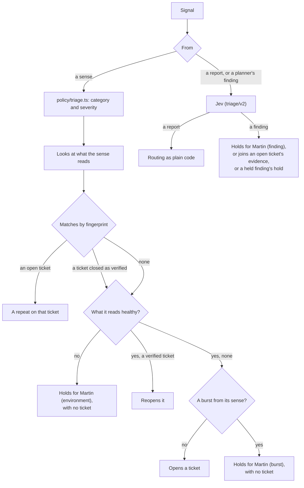

# Triage

An agent: turns signals into tickets. Part of the [factory plane](README.md#agents).

- **Reads:** probe, crawler, telemetry and canary signals; the dependency sense's moves; user reports; the planner's findings.
- **Produces:** deduplicated, classified tickets with evidence.
- **v1:** `packages/triage`, run by `factory triage`. It takes signals from [the inbox](ORCHESTRATOR.md#the-inbox).

## Every signal

- **A sense's signal** takes its category and severity from `policy/triage.ts`, and repeats by fingerprint. Its ticket's title says what was seen and where, and names what failed where the evidence does: "Content-Security-Policy and X-Frame-Options are missing on every page", or how many headers when their names would not fit.
- **Only reports and the planner's findings go to Jev** (`triage/v2`), with routing as plain code.
- It quarantines injection attempts, and parks suggestions for Martin, which close when he [rejects them](#a-suggestion). A quarantine is recorded as typed judgement refusing the report (`action.refused`, mechanism `typed-judgement`, guardrail 8), on the quarantined work item before it closes, appended as triage's role, the only role that may append a refusal by typed judgement (`policy/refusals.ts`). Its output is Jev's typed answers verbatim, with their probabilities, one line an answer; never the report's words, nor the questions, which are the factory's.
- **A report's ticket points at what was reported** ([below](#what-a-reports-ticket-points-at)), from the page as the factory read it, never the visitor's words.
- **One fingerprint, one ticket**, except that a report joins an open ticket only when both point at the [same thing](#a-report-on-a-ticket-it-repeats).
- **More new problems than a handful from one sense at once** wait for Martin as one [burst](#a-burst), before any has a ticket. An open ticket's problem seen again where no release explains it counts as new.
- **A new problem seen while what its sense reads was not healthy** waits for Martin too, its cause [the environment](#what-a-sense-reads).

## What a report's ticket points at

A report's ticket says what was reported, in the factory's words, so that every agent, the issue and the console are told it (`points` on `ticket.opened`, `packages/events/src/points.ts`). Its title only names the symptom and the route, which any fault of that kind there would fit.

- **The page** the visitor sent it from, as a path with no query and nothing private in it, and only when the [page reader](PROBES-AND-CRAWLER.md#the-page-reader) read it and it answered 2xx there, not at the end of a redirect: a path no page has may be words a visitor typed, so it never reaches an agent.
- **A passage or an element of it**, which Jev chooses from the page as the factory read it, or none, by what the report describes (`POINTED_BY`):

| Jev judged it | It points at | Asked |
|---|---|---|
| Content, whatever its symptom; or `wrong-result`, `low-contrast` | A passage of the page's text | `passage/v1` |
| `broken-link` | A link | `element/v1` |
| `broken-image`, `missing-alt` | An image | `element/v1` |
| `unlabelled-field` | A form field | `element/v1` |
| `rejects-valid-input` | A form field or a button | `element/v1` |
| Any other symptom: one of the whole page, such as an error, slowness, a header or the logs | Nothing narrower than the page | Nothing more |

A ticket that points at nothing narrower than the page, whatever the reason (the symptom, Jev's none, or a page that could not be read), waits at Plan for Martin to describe what is wrong before any planner starts ([a report that names only its page](ORCHESTRATOR.md#a-report-that-names-only-its-page)).

Faint text is text: a link's or a button's words in the page's main text (`<main>`, or the whole page when it has none) are among the passages too. An element is the page's own markup: a link by its words and its path on the app, an image by its description and its path, a field by its label, its `name` and its type, a button by its words. An address off the app is named as such, a query or a fragment is cut, and a field's value is never read. Jev's answer is a label from the options it was offered, so nothing it writes reaches the ticket. A content ticket's fingerprint is its passage too; every other ticket keeps its route and symptom as its fingerprint, which the scoreboard matches. A planner's finding, which opens no ticket, is never asked what it points at, only a content one's passage, which its hold's fingerprint holds.

### A report on a ticket it repeats

A report joins an open ticket, as a repeat, only when the two point at the same thing: the same passage, or the same element, of the same page, or neither at anything narrower than its page (`samePoints`). A ticket a sense opened points at nothing. Otherwise the report opens a ticket of its own, with its own points, though its fingerprint is the open one's: a second report about another link on the page would otherwise be counted on the first link's ticket, and no ticket would point at what it reported. This holds for an open ticket Jev chose as the one the report repeats, so a repeat is asked what it points at too, as the ticket it would open alone, and for one with its fingerprint. Of two open tickets with one fingerprint, a sense's signal adds its evidence to the newer.

## One copy at a time

Triage decides one signal at a time, holding an advisory lock on a connection of its own, so two signals with the same new fingerprint cannot open two tickets. A second copy waits, asking for the lock every two seconds (`LOCK_ASKED_MS`) and whenever it is woken.

A store it cannot reach, such as Postgres restarting, is waited out, not exited on, as triage starts too: 1 s after the first failure, then twice as long each time, up to 30 s. The lock goes with its connection, so after any failure triage lets go of it and takes it again on a new connection before it takes another signal, and it asks that connection before each pass, and appends on it, in a transaction of its own: a copy that has lost the lock appends nothing, gives back the signal it had in hand with its attempt, due at once for the copy that holds the lock, and waits while another holds it. A signal in hand when the store went is taken again once its lease is up, as after a restart; its events have ids from the signal, so none is appended twice. Twelve failures in a row, three and a half minutes with nothing triaged, is no blip: triage exits, and its restarts page Martin (`WorkerCrashLooping`, unless `StoreDown` already has).

## A move

The [dependency sense](PATCHING.md#what-it-sends-triage) sends each of the app's moves for the line as a `dependency` signal: the move (its repository, name, ecosystem, from, to and pins) where every other sense names a route, and the scan's findings as evidence. No model judges it, and nothing of it is held: a day's moves arrive together by design, so the [burst](#a-burst) hold does not count this sense, and it reads nothing [triage looks at](#what-a-sense-reads).

- **One move, one open ticket.** Its fingerprint is the move's name and ecosystem, with no version and no advisory, so every target and finding of one move is one ticket's. A lockfile's move is named by its package, so each package of the lockfile has a ticket of its own.
- **Its ticket.** A work item of kind `dependency-update`, with its pin (`dependency`: name, ecosystem, from, to, and whether a vulnerability is why), and its ticket, category `security`, whose severity is the policy's reading of the move's worst finding with a fix (`vulnerableSeverity`: High or Critical `broken`, Medium `degraded`, Low `cosmetic`), from the scan's ratings alone. An advisory's words are never read: only a finding's fixed fields.
- **The same move again** (the next day's scan, or the sense restarted, as every deploy of the `factory` image restarts it) is counted, with no event, while it says what the ticket's last signal said: the same target, and the same findings by their advisory, package, ratings and fixed versions, with the same counts of the rest. A deadline that moved is not a change.
- **A new target or new findings** join the ticket as evidence. When the worst finding with a fix is worse than the ticket's severity, triage raises it (`ticket.rated`: the severity and what it was), and the line's queue, its agents' ticket and the console read the worst of the ticket's opening and its ratings. A better day lowers nothing.
- **A ticket closed** any way but verified (by hand, `make close-work-item`, as Martin's) leaves the move with no open ticket: its next signal opens a new one. One closed as verified [reopens](#reopening-a-verified-ticket) on a signal seen after the close, naming its move in place of a route, and its severity rises if the move is worse.
- **In public** a ticket's events name no advisory, no finding's package and no version that fixes one, and a vulnerable lockfile move's package and versions are withheld, always: its signal names its lockfile ("a package in `pnpm-lock.yaml`"), its ticket's title reads "Move a package in `pnpm-lock.yaml`", as the [day's moves](PATCHING.md#the-day) do, and the issue the line opens from the private payloads is where they become public, which the line records as `issue.opened` ([the orchestrator](ORCHESTRATOR.md#taking-work)). A spec's criteria, whose quotes may be a finding's line, reach the public with no quote, for every work item. An image's or Node's move keeps its name and versions, as the day's moves show them.

## Matching an open ticket

A sense's signal on an open ticket adds its evidence (`signal.received`) the first time that sense sees it in each version of the app. So the ticket records every version the problem was seen in, so every version of the app rolled back on it, and the planner is told each. Within a version, the inbox counts it (outcome `counted`) and nothing is appended: the events grow with tickets and releases, not with the minutes a defect stays unfixed.

Nothing reads a counted signal again, so triage deletes each three days after it arrived (`INBOX` in `policy/triage.ts`), when it starts and every hour. It keeps each sense's newest signal, from which a restarted watcher takes up, and the canary's, whose ids the line sends again after a restart. Signals that opened a ticket, are held, or still wait stay: triage's burst and hold reads look at them.

- An open ticket on `*` (a class the crawler found on every page) takes its class's signals on any route.
- But not where the canary is on either side: the canary's `*` means worse on more than one route, or on routes its analysis could not name, so it matches only another canary `*` ([rollback signals](RELEASE-AND-VERIFY.md#rollback-signals)).

## Reopening a verified ticket

A sense's signal that no open ticket has, on the exact fingerprint of a ticket closed as verified, reopens it (`work-item.reopened`, naming its route, or a move's name and ecosystem; then the signal): the same defect came back, and [the line](ORCHESTRATOR.md#a-ticket-that-reopens) takes the work item back into Plan.

It counts as a repeat on that ticket instead when:

- the sense saw it before that close: it is of the version the fix replaced;
- the ticket's last verification was a dry run's, whose fix never shipped. The line reopens that ticket when it runs live ([after a dry run](ORCHESTRATOR.md#after-a-dry-run)).

A report or a planner's finding never reopens a ticket.

## A burst

A sense that finds many new problems at once may have found as many defects, or one fault in what it reads, such as a gap in the log that looks like a missing record on every page. Each ticket would be a planner's step and more, so triage holds a burst for one look from Martin instead (cause `burst`).

- **What counts.** A sense's signal that would open a ticket, when with it that sense has found more than five new problems within ten minutes of it (`BURST` in `policy/triage.ts`, human-owned). It counts the tickets the sense opened in that time, and the new problems in its signals still waiting in the inbox, so a burst that arrives at once is held from its first signal. One that reopens a verified ticket never counts.
- **An open ticket's problem, seen again.** A signal that would add evidence to an open ticket, the first time its sense sees it in a version, counts as a new problem, and is held as one, unless a release explains it: its version went live at most thirty minutes before it arrived (`BURST.releaseMinutes`). A release puts a version live when its canary starts, when it is promoted, and when a rollback, an abort or an analysis's error restores it, as the line records; for a release the line did not watch, when a sense first saw it. Every sense sees each open defect again within a run or two of a release, which is the release's doing; a sense seeing many of them again on a version long live, at once, has had them stop and start again, or has a fault in what it reads. A repeat in a version the ticket has it in never counts.
- **What it holds.** One work item, held at Triage with no ticket, so nothing of it reaches Plan, nor any open ticket. Each new problem the sense finds while it waits joins it as evidence, however long after; one it holds already is counted. Other senses carry on as ever.
- **A fresh app.** The line's first start on a fresh app finds many problems by design, and costs this one answer: a first look at what the senses see is worth it, and approving lets them all through.

### Martin's answer to a burst

And to problems held for the environment.

| Answer | Does |
|---|---|
| Approve | Makes of each problem what it would have made without the burst, in the order the sense sent them: a ticket, as a rule, which the line takes in its turn, or evidence on its open ticket, opened before or since. Closes the burst, naming the tickets |
| Reject | Closes it with no ticket. A problem the sense still sees is found again, and counts toward a burst afresh |
| Answer in words | Leaves it waiting: it is still held, and Needs you lists it, until he approves or rejects it |

Triage does as he answered once an event is appended, as for a finding.

## What a sense reads

Each sense reads something besides the app, and when that fails a sense can see the app as broken. A Loki on a full disk stores no records, and the log watcher would see a missing record on every page. No agent can mend a full disk or a backend that stores nothing, so triage looks before it trusts a sense's signal.

- **What each reads.** `ENVIRONMENT` in `policy/triage.ts` (human-owned): the log watcher reads Prometheus, Loki and Tempo; the metrics and the canary, Prometheus; every sense, the disk under the cluster's volumes, which the app, the senses and the backends share.
- **Healthy.** Prometheus, when the targets whose series the senses read (`ENVIRONMENT.targets`) are there and `up`, and metrics still arrive over OTLP, where the app's own are: Traefik, whose requests the canary's analysis counts, and each node's kubelet, whose volume stats are the disk's measure. Any other target down, such as a platform controller crash-looping, holds nothing; one of these down is named by its namespace and pod, or its node, in the hold's reason. Loki, when it stored a record sent over OTLP in the five minutes before, the pod log collector's aside; Tempo, a trace in the ten minutes before. "Answers" is not enough: a Loki on a full disk answers every query, and returns nothing. The disk, when every volume has a tenth or more free, below which the kubelet starts evicting pods. A backend that cannot be asked, or has no measure, is not seen to be healthy.
- **When.** As of the time the sense saw it, so a signal that waited in the inbox is judged on how things stood then. One look a minute serves every signal seen in it, unless a backend did not answer when asked twice: the next signal asks again.
- **The look is evidence.** Each sense's signal records it (`environment` on `signal.received`): a ticket that opens shows how its sense's dependencies stood when it was seen.
- **What it holds.** A signal that would open or reopen a ticket while anything its sense reads was not healthy is held for Martin as a burst is, with cause `environment`: one work item with no ticket, which every new problem the sense finds while it waits joins. A signal on an open ticket adds its evidence as ever. Martin answers it as [a burst](#martins-answer-to-a-burst).
- **Where it looks.** `factory triage` looks at the backends it has an address for (`PROMETHEUS_URL`, `LOKI_URL`, `TEMPO_URL`; the disk through Prometheus). With none, it looks at nothing and holds nothing for the environment. The cluster's triage has all three.

## A suggestion

A report or a planner's finding that Jev judges a suggestion (a request for something new, not a fault) is parked for Martin (cause `suggestion`), with no ticket: only he asks for improvements.

| Answer | Does |
|---|---|
| Reject | Closes it, with no ticket |
| Answer in words | Leaves it waiting: it is still held, and Needs you lists it, until he rejects it |

A suggestion never starts work, so approving one does nothing, and Needs you does not offer it (spec 5.3: a report only ever leads to a defect fix). Martin, having read one, asks for the improvement himself with the "+" on Plan, in his own words ([admin service](ADMIN-SERVICE.md#an-improvement)): only his roles may open an improvement, and triage never does. Triage acts on his rejection once an event is appended, reading the suggestion holds by an index of their own, and leaves an answer it cannot act on as it leaves [a finding's](#martins-answer-to-a-finding).

## How long a report is kept

A visitor's report is kept for 30 days from when it was received, wherever the factory keeps it: the words they typed, and the page they sent it from as they sent it. Triage forgets each 29 days after it reached the inbox (`REPORT_TEXT` in `policy/triage.ts`), a day short, as it prunes the inbox, when it starts and every hour, so the hour between passes still falls inside the 30 days. A report that waited for the gateway, as one does while a spend cap holds, is forgotten by when it arrived, not when triage got to it, and one that has waited 22 days (`judgeDays`) is never judged at all: it is forgotten unjudged, so Jev's cassette of it, kept seven days, is gone in time too.

- **The events.** The text goes from the report's `signal.received` and from each `judgement.made` Jev made of it, appended with it. The events stay: they are what the console, the audit log and the scoreboard are made from, and the store keeps every event (append-only, but for [this one change](EVENT-STORE.md#the-table)). What is left is valid at its version, as a report read from a public record has no text either, so every view reads it as a report whose words are withheld. The page stays as the event has it, a path with no query and nothing private in it: the factory's own, which the work item's title and the public view give everyone.
- **The inbox.** The report's row goes, triaged or not, with its text and the page as it was sent. The log watcher takes up from the newest report the inbox holds, or from a day back when it holds none, and Loki keeps seven days: nothing could send one that old again.
- **What is not the visitor's stays.** A work item's title, description and story, and a ticket, are the factory's own words, never the visitor's: they quote no report. Jev's answers and the passage of the page it chose are the factory's too. Martin's words on a hold about a report are his own. A planner's finding is the factory's own words, and stays; so do a store's [samples](SAMPLES.md), whose reports are invented.
- **The gateway's cassettes** of Jev's calls hold the report it judged. The gateway deletes each seven days after its last call, whatever else would keep it, and triage asks within 22 days of a report's arrival, so it is gone by the same 29 days ([keeping them](LLM-GATEWAY.md#keeping-them)).

Triage does it through one function the store gives its role (`forget_reports`, `0032_forget-reports.sql`), which runs with the owner's rights and does only that, and never sooner than 29 days, whatever cut triage gives it: the role may change no event, and delete no report from the inbox, itself, so even a compromised triage cannot erase a report, a quarantined one's evidence among them, before its time. A store migrated to it forgets every report already older than that as soon as triage next starts; there is nothing to run by hand.

Elsewhere the text goes sooner, or is the cluster's to keep:

- **Loki** keeps the app's log, the widget's records among them, for seven days, and **Tempo** its traces for three ([telemetry](TELEMETRY.md)).
- **The node's container logs**, the files the app's output is written to before the collector reads them, are rotated by size, not by time, and kubelet has no setting for their age. They go with the pod: every release replaces it, and the shop's weekly dependency and image updates, once Martin merges them, release it well within 30 days. An [alert](ALERTING.md#the-shops-pod) tells Martin when the shop's pod is 25 days old, so that a release replaces it before a report in its logs is 30.
- **Postgres** keeps the old version of a row it changed or deleted until autovacuum reclaims it, which it does on its own.
- **Martin's console** keeps the full events it has read in the tab, and a report forgotten meanwhile is quoted there until the tab loads them again; a session lasts an hour at most.
- **A gateway on the host** in `replay-record`, as [on the host](../ON-THE-HOST.md#the-workers-and-the-gateway) runs one against the cluster's store, prunes nothing: its folder is the one a developer gave it, kept out of the repository, and what it recorded of real reports is theirs to delete.

## The planner's findings

A planner's finding is trusted no more than a report, since a visitor can read the app's public code and argue an agent into seeing a bug. It is judged the same way but never opens a ticket (`routeFinding`). Nothing else opens a ticket from a finding. One quarantined is recorded as typed judgement refusing it, as a report is.

- **A defect it noticed** holds for Martin (cause `finding`), with its fingerprint as a report's ticket would have it: the route the planner named and the symptom Jev judged, or, for wrong words, the passage of the page Jev chose.
- **One that repeats an open ticket** joins its evidence, though never the ticket the planner was planning, which it is beyond. One with that ticket's fingerprint is held, saying so, until that ticket closes and a sense's ticket can take it.
- **One a held defect has.** Another finding with the fingerprint of a defect still held joins that hold, its words kept beside the first's, so one defect waits for one answer.
- **A later ticket.** A ticket triage opens later with the same fingerprint, from a sense or a report, closes the held defect into it ("A sense saw it: ticket #N").

### Martin's answer to a finding

| Answer | Does |
|---|---|
| Approve | Opens its ticket on its own work item, with the category and severity `policy/triage.ts` gives its symptom, as a sense's would be, or joins it to an open ticket that has it |
| Reject | Closes it |
| Answer in words | Leaves it waiting: it is still held, and Needs you lists it, until he approves or rejects it |

An answer settles only the findings that reached the hold before it, in the store's order, however it was written. If one joined after it, triage acts on none of them: the hold starts again on the same work item, and waits for an answer that has read them all.

Triage does as he answered once an event is appended, reading only the finding holds (an index of their own), and only answers one of [Martin's roles](EVENT-STORE.md#martins-commands) appended: any other is ignored, and logged. If it cannot act on his answer in as many tries as a signal gets, it leaves the answer: the hold starts again, saying which answer it could not act on, so Needs you asks him again and a restart has nothing answered to try. His next answer is tried afresh.
